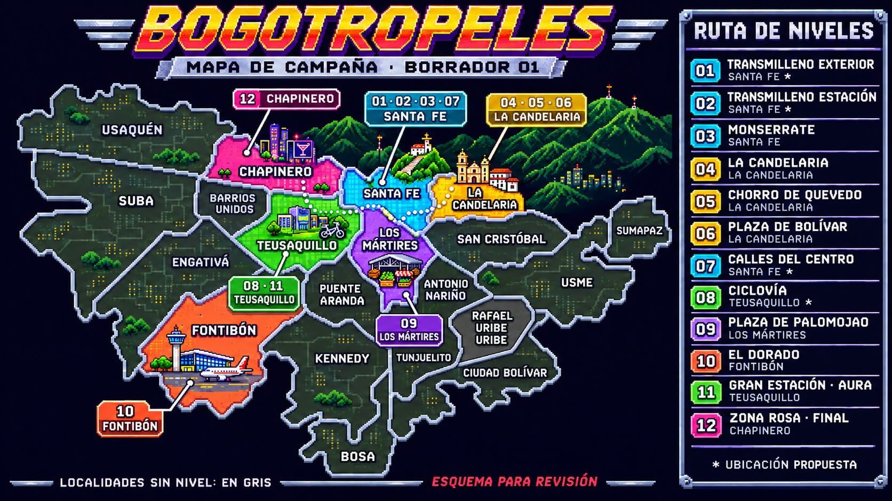

# Mapa de campaña — borrador 01

Propuesta visual para revisar con el usuario. No se modificó la campaña ni se
integró una pantalla de mapa al juego. El orden de niveles sale de `CAMPAIGN`
en `src/data/campaign.js`; no de documentos antiguos con otros órdenes.

Se usa un color por localidad y se agrupan los números de los niveles que la
comparten. Las otras localidades permanecen en gris. El mapa es esquemático,
con la orientación y siluetas de `ejemplos/mapa.jpg` — norte a la izquierda —,
no una cartografía oficial. `ejemplos/MetroCity.webp` se usa como referencia
de pixel art arcade, bordes metálicos y presentación. Bogotá no se representa
como una isla ni se agrega un océano.

## Distribución propuesta

| Color | Localidad | Niveles |
|---|---|---|
| Cian | Santa Fe | 01 Transmilleno exterior*, 02 Transmilleno estación*, 03 Monserrate, 07 Calles del centro* |
| Dorado | La Candelaria | 04 La Candelaria, 05 Chorro de Quevedo, 06 Plaza de Bolívar |
| Verde | Teusaquillo | 08 Ciclovía*, 11 Gran Estación / Batalla de aura |
| Morado | Los Mártires | 09 Plaza de Palomojao, inspirada en Paloquemao |
| Naranja | Fontibón | 10 El Dorado: terminal y accesos representados por el escenario |
| Rosa | Chapinero | 12 Zona Rosa, final |

Los asteriscos son decisiones de diseño pendientes de corrección del usuario:
el proyecto no fija una estación real para Transmilleno; Calles del centro se
interpreta como San Bernardo por el arte/NPC samber; Ciclovía es un escenario
genérico de una actividad que recorre muchas localidades. La propuesta ubica
ese nivel en Teusaquillo. No se atribuye la totalidad de la Ciclovía a esa
localidad. La ubicación de El Dorado corresponde a la terminal y su acceso,
no a todo el recinto aeroportuario ni sus pistas.

Los bonus no se convierten en niveles 13 y 14: Chiva hereda el sector propuesto
para Calles del centro; el ring secreto puede heredar Zona Rosa si se incorpora
al mapa en una iteración posterior.

## Fuentes consultadas

- [Santa Fe: barrios y veredas, incluido Monserrate y San Bernardo](https://santafe.gobiernobogota.gov.co/content/upz-barrios-y-veredas).
- [Secretaría de Educación: La Candelaria, Plaza de Bolívar y Chorro de Quevedo](https://www.educacionbogota.edu.co/direcciones_locales/quienes-somos-lacandelaria).
- [Jardín Botánico: Paloquemao en Los Mártires](https://jbb.gov.co/cronica-de-punto-critico-de-basuras-a-un-espacio-florecido-la-historia-de-la-jardinera-de-paloquemao/).
- [Alcaldía de Teusaquillo: Gran Estación](https://teusaquillo.gobiernobogota.gov.co/milocalidad/sitios-interes).
- [Alcaldía de Chapinero: Zona Rosa](https://chapinero.gobiernobogota.gov.co/milocalidad/sitios-destacados-la-localidad).
- [Alcaldía de Bogotá: sector y vías de acceso a El Dorado en Fontibón](https://www.alcaldiabogota.gov.co/sisjur/normas/Norma1.jsp?dt=S&i=32452).

La asignación editable y las distinciones entre verificación y propuesta están
en `localidades.json`. Colores y números son ilustrativos de la campaña, no
una clasificación administrativa de Bogotá.

## Procedencia

ImageGen integrado, con las dos imágenes aportadas como referencias. Se
conservan los PNG generados sin modificar su metadata. El primer resultado
(`mapa-bogota-borrador-01-inicial.png`, fuente
`exec-f7349ea9-e09e-496b-84b3-663338ba5984.png`) omitió Rafael Uribe Uribe;
se solicitó una corrección localizada para recuperar las 20 localidades.
El prompt inicial está en `prompt-inicial.txt`.

Resultado corregido para mostrar al usuario:
`mapa-bogota-borrador-01.png`, fuente ImageGen
`exec-7a824c4f-20d4-4e34-99b9-53030631db54.png`. La edición añadió Rafael
Uribe Uribe entre Antonio Nariño, Usme, Tunjuelito y Ciudad Bolívar, preservando
los colores, números y leyenda. Se revisaron visualmente las 20 etiquetas de
localidades y los 12 renglones de campaña. Las ubicaciones con asterisco siguen
siendo propuestas, sin aprobación todavía.

Actualización: el usuario confirmó la distribución propuesta: Transmilleno
exterior/estación en Santa Fe, Calles del centro en San Bernardo–Santa Fe y
Ciclovía en Teusaquillo. `localidades.json` registra estas ubicaciones como
decisiones de diseño aprobadas. Los asteriscos de la imagen del borrador 01
son anteriores a esta confirmación; ya no representan dudas de ubicación.
Esta aprobación no implica integrar todavía una pantalla al juego.

