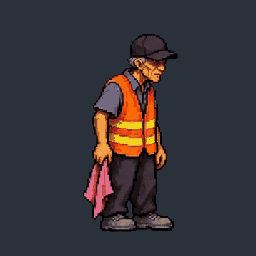
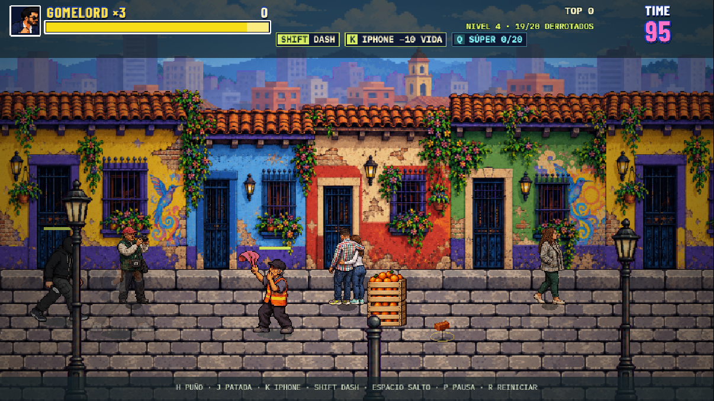

# El Cuidacarros

Enemigo de apoyo inspirado en `ejemplos/cuidacarros.jpg`: gorra negra, camisa azul grisácea, chaleco naranja reflectivo y bayetilla rosada. No causa daño ni inicia ataques, incluso al forzar un ataque desde el controlador.

Espera 3,6 segundos y anuncia la llamada durante 1 segundo antes del primer silbido. Después llama cada 7,5 segundos (6,5 de espera y 1 de preparación). Agita la bayetilla durante la preparación y medio segundo después del silbido. Los golpes, agarres y caídas cancelan la preparación; al recuperarse tiene 1,8 segundos de espera antes de volver a prepararla. La pausa, las cinemáticas y el hitstop detienen su reloj.

Cada silbido audible crea exactamente un enemigo aleatorio del conjunto del nivel. Excluye jefes, esbirros especiales y otros cuidacarros para impedir llamadas recursivas. Los refuerzos conservan su comportamiento normal, sobreviven a la muerte del llamador y deben ser derrotados para terminar el encuentro. No alteran el cupo de enemigos de la campaña.

Asignado a Transmilleno exterior, Plaza de Bolívar, La Candelaria, Chorro de Quevedo, calles del centro, Zona Rosa y El Dorado. No aparece en el interior del bus, la plaza de mercado ni los modos de bonificación. Estadísticas base: 100 de vida, velocidad 95, altura 106 y daño 0, conservado al escalar la dificultad.

Sonidos:

- Golpe recibido: `hurt2.mp3`.
- Muerte: `enemy_1_die.mp3`.
- Llamada completada: `whistle.mp3`.

El original generado se conserva en `prompts/cuidacarros/source.png`. `python scripts/prepare-cuidacarros.py` reproduce el atlas `src/data/enemies/cuidacarros.png`: dieciséis celdas de 256 × 256, escala compartida, 48 colores, transparencia sin suavizado y suelo alineado. Cuatro poses de movimiento, cuatro de llamada, cuatro de daño y cuatro de derrota.

Verificación: 656 pruebas aprobadas y compilación de producción correcta. Prueba en Chrome con dos silbidos separados por 7,5 segundos: dos refuerzos del nivel, ninguna acción ofensiva, los tres audios cargados y reproducidos, refuerzos supervivientes al llamador y contadores correctos al limpiar el encuentro.

