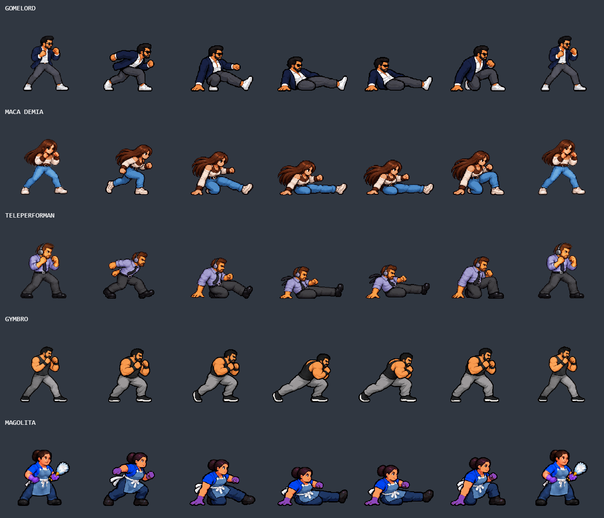

# Patadas deslizantes y hombrazo

Se reemplazaron las seis poses del dash con patada de Gomelord, Maca Demia,
Teleperforman y Magolita, y las seis del hombrazo de Gymbro. Las anteriores
cambiaban de anatomía, tamaño de cabeza y densidad de píxel entre poses.

Las cinco poses de movimiento de cada personaje comparten una sola escala,
medida contra su guardia original. La sexta pose es una copia de esa guardia.
Los colores se normalizan a la paleta del personaje base, con alpha duro y
remuestreo nearest-neighbor. Cada celda mide 320 × 320, tiene el eje de cadera
en x=160 y el apoyo en y=279. No se iguala la altura de las poses agachadas a
la de pie. Se eliminaron las compensaciones individuales de escala del runtime.
Los índices de ataque y sus tiempos de contacto se conservan; se actualizaron
los offsets de los combos aéreos, patadas de Magolita y piledriver que siguen
a estas tiras en el atlas.

La patada baja independiente de Maca Demia (L, poses 12–15) ya pertenece al
atlas original; conserva su arte y funcionamiento.

## Fuente y reproducción

Las cinco imágenes fuente fueron generadas con ImageGen integrado usando como
referencia cada fila de `dash-attacks-before.png`: la primera figura es la
guardia auténtica y las siguientes son los ataques que se debían corregir.
Los originales con su metadata están en `prompts/dash-attacks/player_N.png`.
El procesamiento determinista está en `scripts/prepare-dash-attacks.py` y sus
medidas quedan en `dash-attacks-normalization.json`.

Prompt común: reconstruir seis poses a partir de la identidad, cara, masa
corporal, vestuario y estilo de la primera figura; no copiar los cuerpos más
pequeños de las poses defectuosas. Seis sprites en una grilla 3 × 2, 1536 × 1024,
fondo transparente, mirando a la derecha, escala anatómica compartida, pixel art
de arcade con contorno escalonado y paleta limitada. Para las patadas:
anticipación, descenso, impacto con pierna derecha extendida a ras del suelo,
continuación, recuperación sobre rodilla/mano y guardia original. Para Gymbro:
anticipación, lanzamiento, impacto con hombro al frente y brazos recogidos,
continuación, recuperación y guardia. Sin texto, efectos, sombras ni escenario.
Se especificaron por separado el vestuario y los accesorios de cada personaje.

## Impacto secundario del piledriver

Ahora el rival alcanzado al aterrizar también entra en el estado de caída.
Mantiene el daño de un puño normal de Gymbro (38), una sola vez; la víctima
agarrada sigue recibiendo el golpe principal de 110. El impacto conserva las
restricciones de alcance, profundidad e inmunidad y no alcanza rivales en el
aire. El aterrizaje resuelve la caída antes de una evasión por presión en el borde.

## Verificación

615 pruebas y build de producción correctos. Chrome cargó los cinco atlas sin
errores; la captura `dash-attacks-engine.png` muestra las texturas procesadas
por Phaser. Una ejecución real del piledriver confirmó víctima 1000 → 890 y
rival secundario 1000 → 962, estado `down`, pose de impacto 67.

