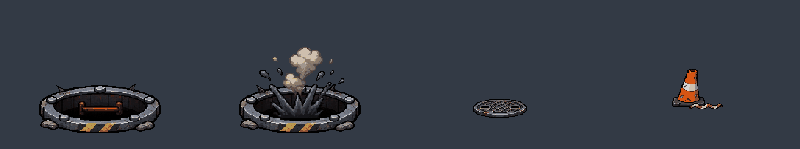
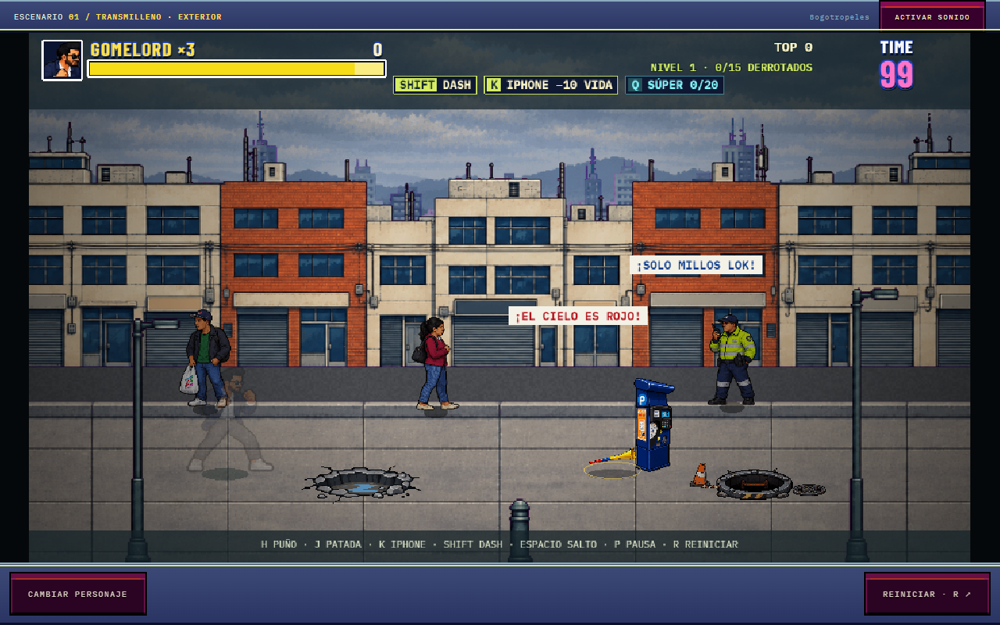
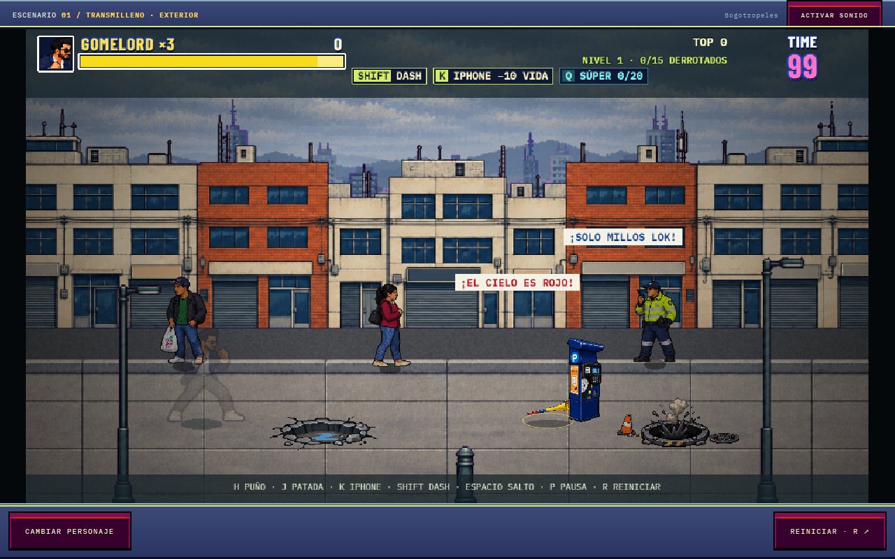

# Alcantarilla de cuatro fotogramas

Atlas activo: `src/data/hazards/manhole-v2.png`, PNG RGBA de 1024 × 192,
cuatro celdas de 256 × 192, fondo realmente transparente, alpha duro,
64 colores compartidos y remuestreo nearest-neighbor. Centro del piso en
(128,140), escala de juego 0.5; misma elipse de colisión y posiciones existentes.

0. Abertura negra con pared interior, primer peldaño oxidado y aro desgastado
   con pintura amarilla/negra.
1. La misma abertura con salpicadura oscura y columna de polvo.
2. Tapa de hierro fundido con relieve y óxido, como pieza independiente.
3. Cono naranja/blanco inclinado, con cinta roja/blanca rota sobre el piso.

Al caer un enemigo, se muestra el fotograma 1 durante 360 ms y luego el 0.
El efecto solo se activa después de que la caída fue aceptada; no se muestra
si el enemigo bloqueó el daño. Los puntos y la muerte no se repiten al terminar
la animación. El efecto respeta la pausa. La tapa y el cono usan los nuevos
índices 2 y 3. Sustituye el burst de partículas anterior de esta caída.

## Generación y procesamiento

ImageGen integrado, 6 de noviembre de 2026. Se siguió el prompt del usuario:
cuatro elementos aislados en una fila, cámara baja y piso muy achatado,
pixel art de arcade de los noventa, sin carretera completa, personajes,
sombras proyectadas ni texto. Referencia de estilo: la alcantarilla anterior.
Se añadieron únicamente las coordenadas de celdas y márgenes para facilitar
la integración. Original con metadata conservada:
`prompts/street-hazards/manhole-v2.png` (2172 × 724), generado como
`exec-57d69ab3-30f7-4e0f-923f-215e5abcdd77.png`.

`scripts/prepare-street-hazards.py` corrige una deriva de cinco píxeles en el
borrador, copia el aro base al fotograma de impacto y superpone el efecto solo
en la abertura y la región superior. Conserva el contorno y el labio delantero.
Normaliza la pintura desgastada hacia amarillo para separarla del óxido y del
cono. El pivote del cono sigue su base, no el centro de la cinta a su lado.
Los archivos de la versión anterior se conservan.

## Verificación

Suite completa: 639 pruebas correctas. Las 13 pruebas específicas de peligros
y arte también pasan con la paleta final. Compilación correcta. Chrome confirmó
4 fotogramas, tapa/cono 2 y 3, caída con HP 100 → 0, estado `sinking`, efecto
0 → 1 → 0 y ningún error de página. Las capturas colocan ambos peligros en el
mismo tramo solo para revisión visual.

