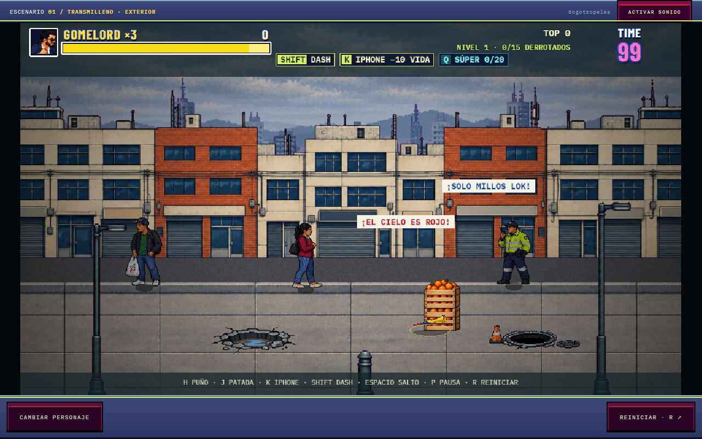
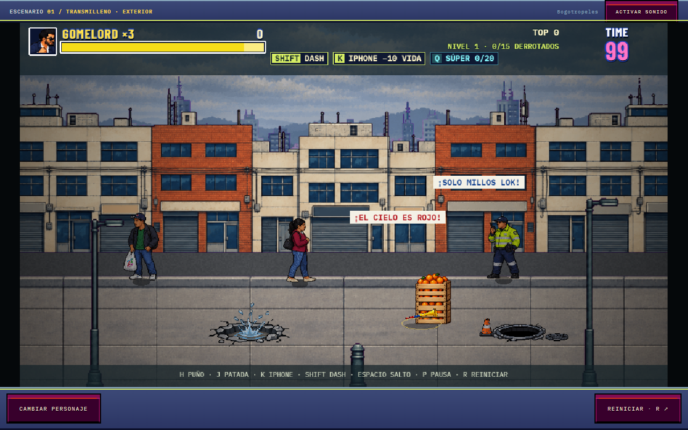

# Huecos y alcantarillas con sprites

Se reemplazó el dibujo procedural del piso en `StageHazards` por dos atlas PNG
transparentes. Las posiciones, elipses de colisión, ralentización, daño, puntos
y caída por la alcantarilla conservan sus reglas existentes.

- `src/data/hazards/pothole.png`: seco, charco y charco con salpicadura.
- `src/data/hazards/manhole-v2.png`: abertura, caída con polvo/salpicadura,
  tapa retirada y cono con cinta. La tapa y el cono se colocan a los lados.
  La versión anterior `manhole.png` se conserva como fuente histórica.

Los atlas tienen celdas de 256 × 192 y alpha duro: 3 fotogramas/40 colores
para el hueco y 4 fotogramas/64 colores para la alcantarilla v2. Se dibujan a
escala 0.5 con el centro del piso en (128,140). Así el
interior del hueco coincide con su elipse de colisión, sin igualar la altura del
fotograma con salpicadura a los otros. El borde del hueco se copia del estado
seco para que no cambie de contorno. El estado húmedo se usa en niveles con
lluvia configurada; la salpicadura de 260 ms se activa cuando un cuerpo cae
en él, pausa con el juego y vuelve al fotograma de reposo sin repetir el daño.

## Procedencia

Generados con ImageGen integrado el 6 de noviembre de 2026. Los originales con
metadata de procedencia están en `prompts/street-hazards/pothole.png` y
`manhole.png`. Referencias de estilo: piso del nivel 1 y caneca del juego. Para
la alcantarilla se usó además el hueco recién generado, conservando su paleta y
perspectiva. Fuentes de la sesión:

- Hueco: `exec-ec0abf5f-df3d-4dac-89a2-727e2d6d4f44.png`.
- Alcantarilla: `exec-8f36624d-93e3-4f7d-866e-246705708000.png`.

Se siguió el prompt del usuario: tres estados aislados del mismo hueco en una
fila, cámara baja con elipse aproximadamente 3.5 veces más ancha que alta,
asfalto quebrado, pared oscura, grava, charco barroso con reflejo azul y
salpicadura central. Fondo transparente sin personajes, carretera completa,
sombras proyectadas ni texto. Para la alcantarilla se pidió una abertura negra
con aro metálico y concreto roto, tapa independiente achatada y cono naranja
con banda blanca y base de caucho negra, todos en pixel art de arcade.

Procesamiento reproducible: `python scripts/prepare-street-hazards.py`.
Se endurece el alpha, se separan las celdas, se comparte el borde del hueco,
se remuestrea con nearest-neighbor sobre el mismo origen y se limita la paleta.
Los originales generados permanecen intactos.

## Validación

638 pruebas aprobadas y compilación de producción correcta. Las pruebas nuevas
comprueban transparencia, márgenes, borde común, creación de sprites sin
Graphics, tapa/cono independientes, pausa y retorno de la salpicadura. Chrome
confirmó los dos atlas, escala 0.5, cambio 1 → 2 → 1 y daño 1000 → 965 al caer,
sin errores de página. La captura de QA coloca los dos peligros juntos para
compararlos; las posiciones de producción no se modificaron.

